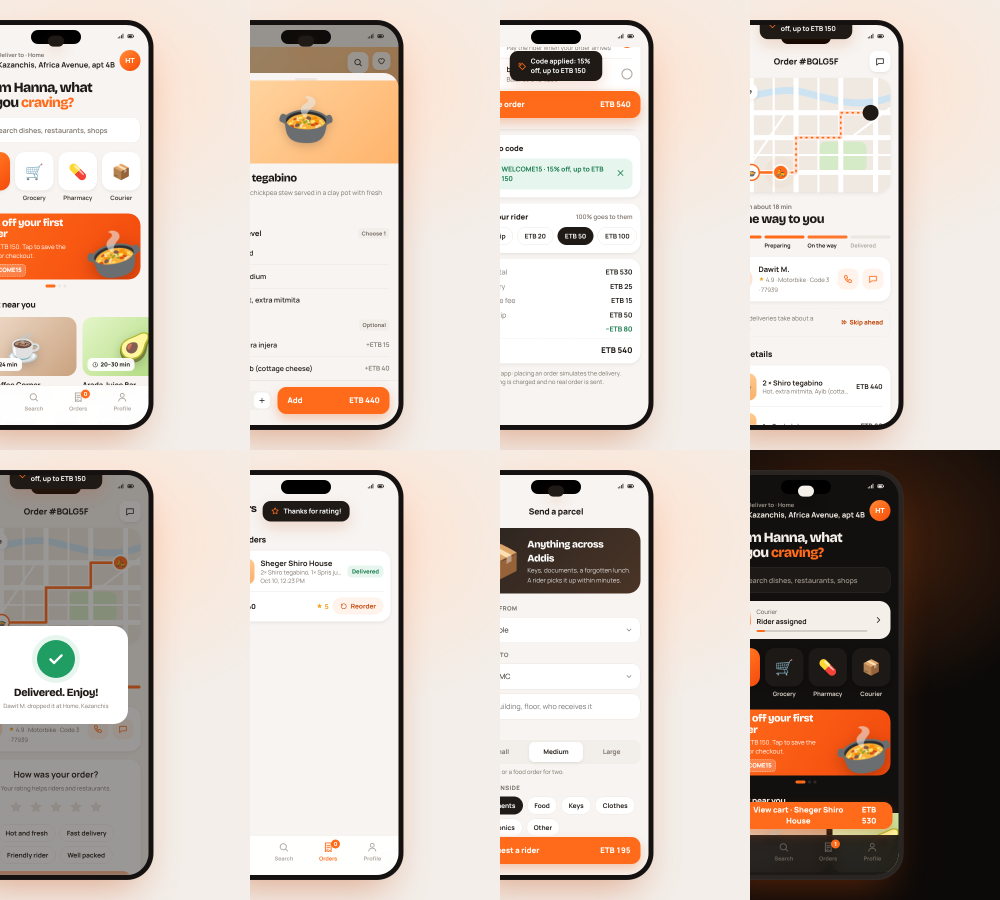

# beU Delivery — working redesign

A clean, modern redesign of the beU Delivery app that keeps its orange identity
and **works end to end**. Open [`index.html`](index.html) in a browser (on a
phone it runs full screen).

## What works
- **Onboarding**: your name and delivery area.
- **Home**: services (Food, Grocery, Pharmacy, Courier), rotating offers, category filters, sort (recommended / fastest / top rated / lowest fee), favourites. Fees and delivery times change with the delivery address.
- **Restaurant menus**: dish options (spice level, extras, size, combos), notes for the kitchen, quantity. One cart per store, with a prompt before switching.
- **Cart and checkout**: quantities, saved places, ASAP or scheduled delivery, cash, wallet or mobile money, promo codes `WELCOME15` and `FREEDEL`, rider tip, minimum-order and wallet-balance checks.
- **Live tracking**: an animated map with the rider moving along the route, progress steps, rider card, and a "Skip ahead" button. A delivery takes about a minute.
- **After delivery**: rating with tags, reorder, order history.
- **Courier**: send a parcel between areas, with size, contents, a live price quote and tracking.
- **Search**: live search across places and dishes, recent and popular searches.
- **Profile**: editable name, demo wallet top-up, saved places, favourites, dark theme, order-update banners, reset demo.

State is kept in the browser (localStorage). Orders, payments, calls and riders
are simulated. Restaurants, people and prices are made up.

## Public build
`./build-public.sh` writes `public/bela-delivery.html`: the same app renamed to
the fictional brand **Bela**, for sharing.

*Unofficial concept, not affiliated with beU Delivery.*
