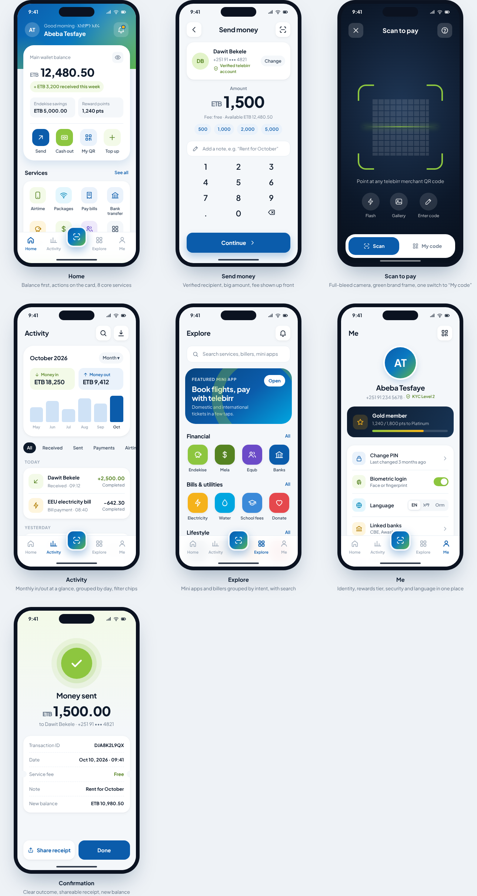

# telebirr — redesign concept

An unofficial, clean and modern redesign of the telebirr mobile money app.
It keeps telebirr's design language (lime green, telebirr blue, bilingual
English / አማርኛ voice, and the existing services) and refines it.

Open [`index.html`](index.html) in a browser. It holds the design-system
tokens and seven phone screens. Tap the eye on Home to hide the balance.

## Screens
1. **Home**: balance hero card with a hide toggle, wallet sub-balances, and quick actions (Send, Cash out, My QR, Top up). It shows 8 core services, a promo and recent activity.
2. **Send money**: verified recipient, large amount entry, presets, fee shown up front.
3. **Scan to pay**: full-bleed camera with a green brand frame and a Scan / My code switch.
4. **Activity**: monthly money in/out, a 6-month chart, filter chips, transactions grouped by day.
5. **Explore**: mini apps and billers grouped as Financial, Bills & utilities and Lifestyle.
6. **Me**: profile, KYC level, rewards tier, security, and language (EN / አማ / Orm).
7. **Confirmation**: success state, receipt and the new balance.

## Design tokens
| Token | Value | Use |
|---|---|---|
| `--tb-blue` | `#0B5CAB` | Primary actions, active tab, links |
| `--tb-green` | `#8DC63F` | Brand accent, success, positive amounts (text uses `--tb-green-700`) |
| `--grad-brand` | blue → green, 135° | Hero header and scan button only |
| `--surface` / `--card` | `#F4F7FA` / `#FFF` | App background / cards |
| Radius | 10 / 14 / 20 / 28 | Chips / inputs / cards / hero cards |
| Type | Plus Jakarta Sans, Noto Sans Ethiopic | Latin / Ge'ez script |

*Not affiliated with Ethio telecom. telebirr is a trademark of its owner.
All names, numbers and amounts are fictional.*
